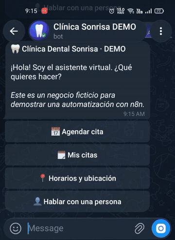
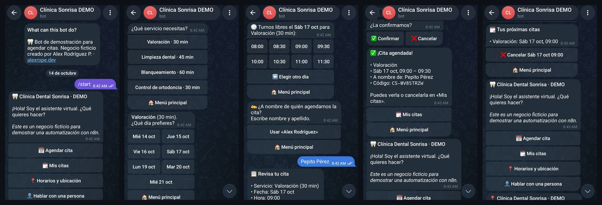
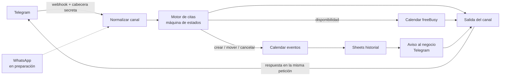

# Bot de citas con n8n: Telegram hoy, WhatsApp mañana

[](https://alexrope.dev/?utm_source=github&utm_medium=readme&utm_campaign=bot-citas-n8n#contacto)

Asistente conversacional para **agendar, consultar y cancelar citas**, construido en **n8n** y conectado a **Google Calendar** y **Google Sheets**. La demo usa un negocio **ficticio**, *Clínica Dental Sonrisa · DEMO*, y se adapta a cualquier negocio que trabaje con citas (consultorios, barberías, asesorías, gimnasios) editando un solo nodo de configuración.

**Pruébalo en Telegram:** [@ClinicaSonrisaDemounBot](https://t.me/ClinicaSonrisaDemounBot). Las citas que agendes son de prueba.





## Qué hace
- **Agenda en 5 toques:** servicio → día → hora libre → nombre → confirmación.
- **Solo ofrece horarios realmente libres:** consulta la agenda en Google Calendar (`freeBusy`) y respeta el horario de atención, la duración de cada servicio y una anticipación mínima.
- **Registra todo:**
  - crea el evento en Google Calendar
  - agrega una fila en Google Sheets, que funciona como historial: agendadas y canceladas
  - avisa al negocio por Telegram
- **Mis citas:** cada cuenta ve **solo sus** citas futuras, numeradas y con el nombre de cada una, y puede:
  - **reprogramarlas:** el mismo evento se mueve a otro día y hora libres, sin pedir de nuevo el nombre
  - **cancelarlas:** con confirmación previa, para evitar cancelaciones por un toque accidental; el turno queda libre al instante
- **Límite por cuenta:** máximo 3 citas futuras en la demo, configurable, para evitar abusos.
- **Hablar con una persona:** pasa la conversación al equipo con un aviso inmediato.
- **Recuerda la conversación:** cada usuario tiene su propio estado, que se reinicia tras 2 horas sin actividad.

## Arquitectura



El workflow tiene un único **motor que no depende del canal**. Cada canal solo traduce su formato a uno común (`{ canal, chat_id, usuario_id, nombre, texto, boton }`) y, a la salida, convierte el mensaje común (`{ texto, botones }`) a sus propios botones. Para sumar WhatsApp basta con agregar otra entrada y otra salida; la lógica de citas no cambia.

### Decisiones de diseño
- **Webhook propio en lugar del nodo Telegram Trigger.** La respuesta se devuelve en la misma petición HTTP (método `sendMessage` en el cuerpo). Así los teclados de botones son dinámicos y **el token del bot no queda guardado dentro del workflow**.
- **Webhook autenticado:** Telegram envía la cabecera `X-Telegram-Bot-Api-Secret-Token` y n8n rechaza cualquier petición sin ella (credencial *Header Auth*).
- **Cuenta de servicio de Google** en vez de OAuth. No vence, a diferencia de OAuth en modo de prueba, que expira cada 7 días, y solo tiene acceso al calendario y la hoja que se le comparten.
- **Citas etiquetadas por usuario:** cada evento lleva `extendedProperties.private.usuario = canal:id`, que se usa para listar y cancelar solo las citas propias. Antes de cancelar o reprogramar, el bot comprueba que la cita esté en la lista que se le mostró a esa persona.
- **Errores controlados:** las llamadas a Google y Telegram continúan aunque fallen, el usuario recibe un mensaje claro y Telegram nunca recibe un error 500, así que no reintenta en bucle.
- **Zona horaria explícita:** Bogotá (UTC-5) en el cálculo de turnos y en los eventos.

## Estructura del repositorio

```
workflow/citas-telegram.json   Workflow para importar en n8n (con marcadores en lugar de IDs reales)
codigo/                        Código de los nodos Code, legible y comentado
pruebas/simulacion.js          Simula la conversación completa sin n8n ni Google
docs/capturas/                 Capturas del bot en funcionamiento
```

Prueba local de la lógica, con Node.js 18 o superior:

```bash
node pruebas/simulacion.js
```

## Instalación

**Requisitos:** n8n con HTTPS público (probado en n8n 2.41, self-hosted con Docker detrás de Nginx), un bot de Telegram creado con @BotFather y un proyecto de Google Cloud.

1. **Google Cloud:**
   - Habilita **Google Calendar API**, **Google Sheets API** y **Google Drive API**.
   - Crea una **cuenta de servicio** sin roles y una clave JSON.
2. **Calendario y hoja:**
   - Crea un calendario y compártelo con el correo de la cuenta de servicio, con el permiso *Realizar cambios en eventos*.
   - Crea una hoja con una pestaña `Citas` y estas columnas en la fila 1: `id_cita, fecha_registro, canal, usuario_id, nombre, servicio, fecha, hora_inicio, hora_fin, estado, id_evento`.
   - Compártela con la cuenta de servicio como Editor.
3. **Credenciales en n8n:**
   - *Google Service Account API*: activa *Set up for use in HTTP Request node*, con los scopes `https://www.googleapis.com/auth/calendar https://www.googleapis.com/auth/spreadsheets`.
   - *Header Auth*: Name `X-Telegram-Bot-Api-Secret-Token` y como valor un secreto aleatorio, por ejemplo de `openssl rand -hex 32`.
   - *Telegram API*: el token del bot de la demo.
   - Opcional: otra *Telegram API* para los avisos internos.
4. **Importar** `workflow/citas-telegram.json`, asignar las credenciales en cada nodo y editar **solo el nodo `Configuracion`** con:
   - los IDs del calendario y de la hoja
   - el chat que recibe los avisos
   - los servicios y el horario
5. **Publicar** el workflow y registrar el webhook en Telegram:

```bash
read -rsp "Token del bot: " TG_TOKEN; echo
read -rsp "Secreto: " TG_SECRET; echo
curl -s "https://api.telegram.org/bot${TG_TOKEN}/setWebhook" \
  -d "url=https://TU-N8N/webhook/citas-telegram" \
  -d "secret_token=${TG_SECRET}" \
  --data-urlencode 'allowed_updates=["message","callback_query"]'
unset TG_TOKEN TG_SECRET
```

## Adaptarlo a otro negocio
Todo vive en el nodo **`Configuracion`**:
- el nombre y la dirección
- los servicios con su duración
- el horario por día de la semana
- el intervalo entre turnos
- cuántos días hacia adelante se puede agendar
- la anticipación mínima

No hace falta tocar el motor.

## Próximos pasos
- [ ] **Canal WhatsApp** (WhatsApp Cloud API de Meta):
  - webhook con verificación y firma `X-Hub-Signature-256`
  - normalizador
  - salida con mensajes interactivos (botones y listas)
- [ ] Recordatorio automático 24 horas antes, con confirmación.
- [ ] Volver a comprobar la disponibilidad justo antes de crear el evento, para evitar dos reservas simultáneas en el mismo turno.

## ¿Necesitas algo así para tu negocio?

Implemento bots de citas para consultorios, barberías, centros de estética y cualquier negocio que agende, además de automatizaciones con n8n y sitios WordPress a la medida.

👉 **[Escríbeme en alexrope.dev](https://alexrope.dev/?utm_source=github&utm_medium=readme&utm_campaign=bot-citas-n8n#contacto)** · [LinkedIn](https://www.linkedin.com/in/alexrodriguezp) · [Más proyectos](https://github.com/alexcitos)

## Autor
**Alex Rodríguez P.**: desarrollo WordPress, infraestructura y automatización.
[alexrope.dev](https://alexrope.dev) · [LinkedIn](https://www.linkedin.com/in/alexrodriguezp) · [GitHub](https://github.com/alexcitos)

Corre en el mismo servidor que mi portafolio: Oracle Cloud Always Free con Docker, Nginx y n8n, con monitoreo propio ([monitoreo-n8n-kuma-telegram](https://github.com/alexcitos/monitoreo-n8n-kuma-telegram)).

Licencia MIT.
